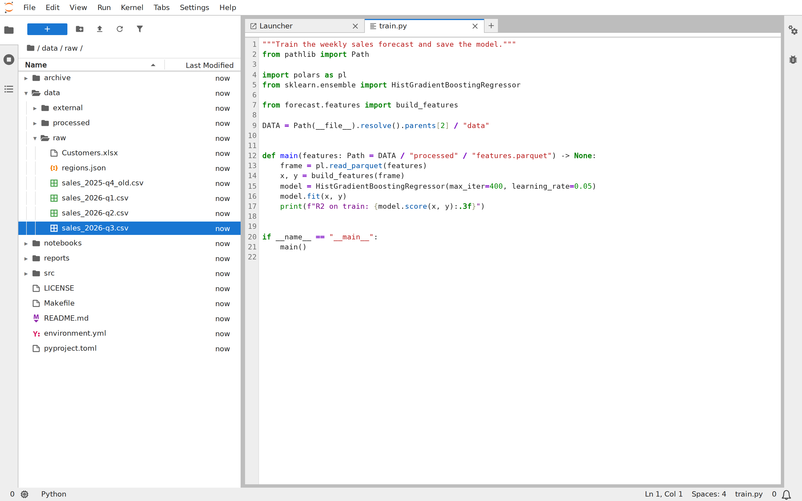
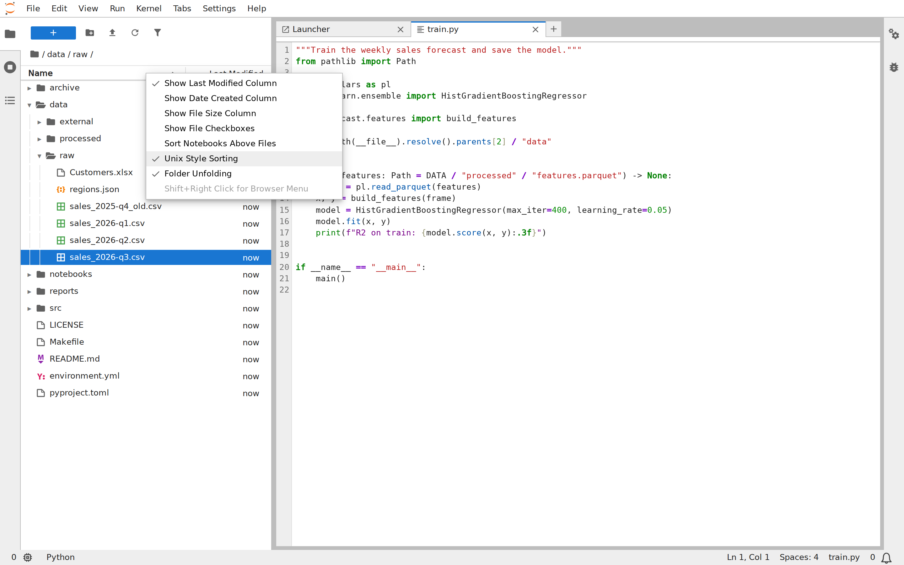
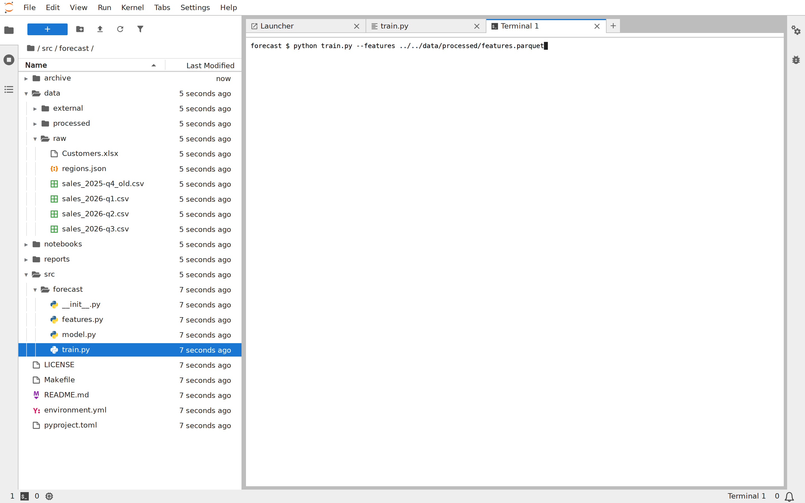
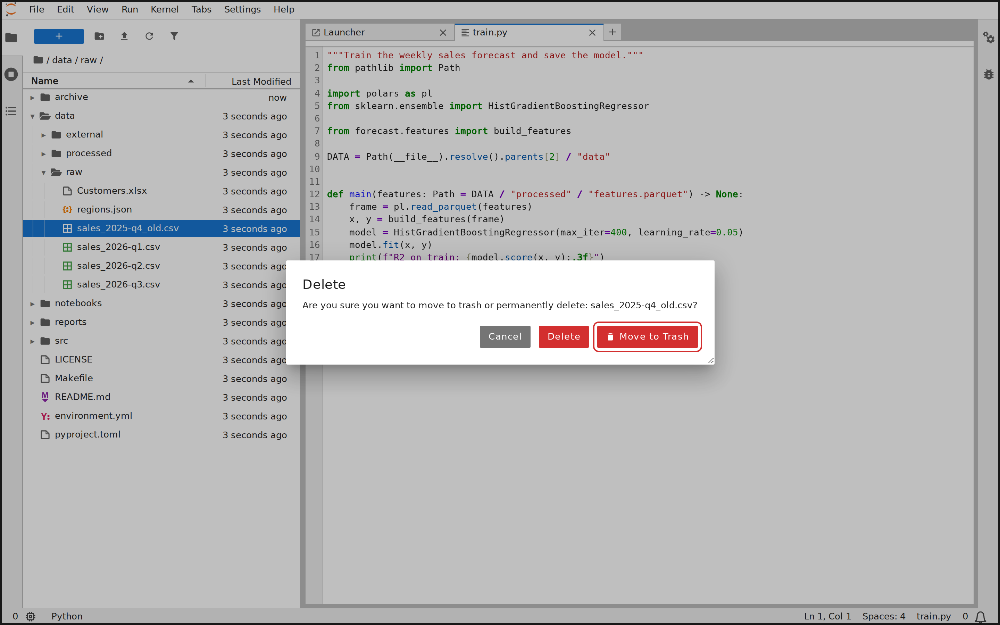
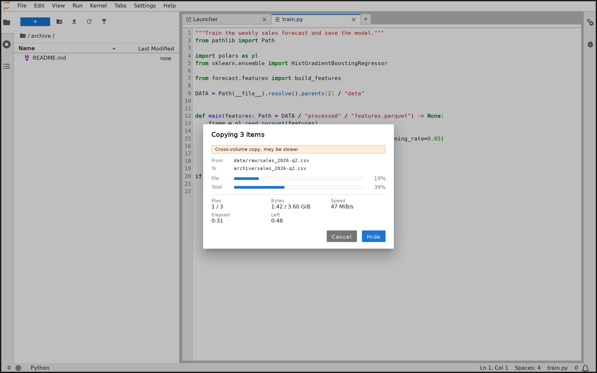
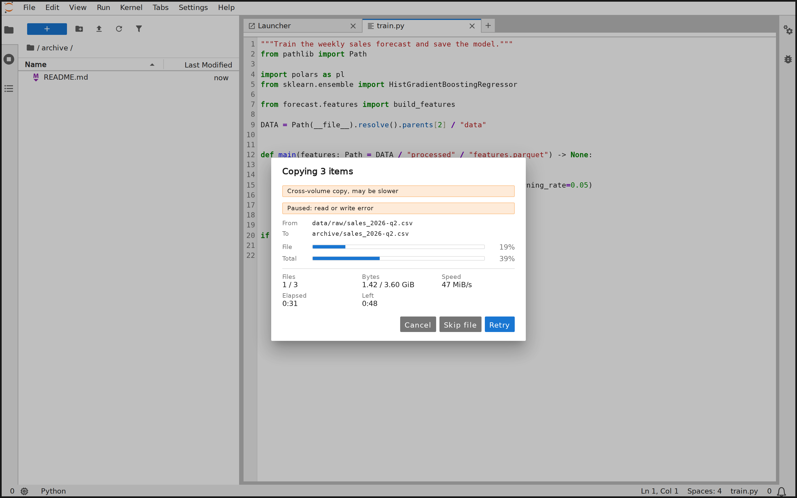

# jupyterlab_advanced_file_browser_extension

[](https://github.com/stellarshenson/jupyterlab_advanced_file_browser_extension/actions/workflows/build.yml)
[](https://www.npmjs.com/package/@stellarshenson/jupyterlab-advanced-file-browser-extension)
[](https://pypi.org/project/jupyterlab-advanced-file-browser-extension/)
[](https://pepy.tech/project/jupyterlab-advanced-file-browser-extension)
[](https://jupyterlab.readthedocs.io/en/stable/)
[](https://kolomolo.com)
[](https://www.paypal.com/donate/?hosted_button_id=B4KPBJDLLXTSA)

Extends the JupyterLab file browser with a folder tree, Unix Style Sorting, Open in Terminal, path drag-and-drop, Move to Trash, and copy and move with a progress dialog.

## Install

```bash
pip install jupyterlab_advanced_file_browser_extension
```

## Features

- **Folder tree** - A triangle on each folder row unfolds the folder in place; a double-click still enters it. Ported from [jupyterlab-unfold](https://github.com/jupyterlab-contrib/jupyterlab-unfold)

  

- **Unix Style Sorting** - Names sort in `LC_COLLATE=C` byte order (dot files, digits, capitals, underscore, lower case), folders first
- **Column header switches** - Right-click the column header to turn Folder Unfolding or Unix Style Sorting on or off; both are on by default

  

- **New items in place** - A new folder, file or notebook shows in its sorted place as soon as the server creates it
- **Open in Terminal** - Right-click a file or the empty area of the listing to open a terminal in that folder
- **Breadcrumb menu** - Right-click a folder name in the breadcrumbs for Open in Terminal, Copy Path, Open and, with `@jlab-enhanced/favorites`, Add to Favourite
- **Path drag-and-drop** - Drag files, folders or a breadcrumb onto a terminal, an editor or a notebook to insert the path. A terminal takes several paths in one drop; a Python file or a Python notebook code cell receives a quoted string or a `pathlib` expression

  

- **Delete dialog** - With the server's trash on, the dialog offers Cancel, Delete and Move to Trash, and Move to Trash is the default. Delete removes permanently, also a folder with content, whatever the server's `always_delete_dir` setting

  

- **Trash only where it is monitored** - Move to Trash is offered for items whose mount point is the home trash's mount point, the server root or a folder in `TrashManagement.locations`. After Move to Trash, a second dialog asks to delete the other items permanently
- **Removal progress** - The Delete dialog warns when more than 10 GiB would go to the trash; a removal that runs longer than 1 second shows a progress dialog
- **Copy and move progress** - A copy, or a move to another volume, made by Paste or by a drop onto a folder runs in a worker thread of the server and shows a progress dialog after 1 second. Hide or Escape closes the dialog and shows the operation on the right of the status bar

  

- **Retry, Skip file and Cancel** - A read or write error pauses the copy or move. Retry continues the file from its last fsync, made every 256 MiB; Skip file goes on with the next file; Cancel stops the operation and keeps the files already finished

  

It replaces `jupyterlab_file_browser_sorting_extension`, `jupyterlab_open_in_terminal_extension` and `jupyterlab_drag_and_drop_path_extension`.

## Settings

Open **Settings → Settings Editor → Advanced File Browser**.

| Setting                                                     | Default        | Effect                                                                                 |
| ----------------------------------------------------------- | -------------- | -------------------------------------------------------------------------------------- |
| Folder unfolding (`folderUnfolding`)                        | `true`         | Shows the folder tree                                                                  |
| Unix style sorting (`unixStyleSorting`)                     | `true`         | Sorts with Unix Style Sorting                                                          |
| Enable drag-and-drop path insertion (`dragDropPathEnabled`) | `true`         | Allows path drag-and-drop and breadcrumb dragging                                      |
| Path type (`pathType`)                                      | `relative`     | `relative` to the terminal's working directory or the document's folder, or `absolute` |
| Python path style (`pythonPathStyle`)                       | `posix`        | `posix` inserts a quoted string, `pathlib` a `Path(...)` expression                    |
| Pathlib constructor (`pathlibConstructor`)                  | `pathlib.Path` | `pathlib.Path` or `Path`; no import is inserted                                        |
| Terminal separator for several paths (`terminalSeparator`)  | `space`        | `space` or `newline`; with `newline`, each line but the last ends with a backslash     |
| Quote paths in the terminal (`terminalQuotePaths`)          | `false`        | `true` puts each path in single quotes instead of backslash escapes                    |

A relative terminal path is measured from the working directory of the deepest shell in the terminal, which can be a background job. Saved values of the former Drag and Drop Path settings are not carried over.

Server options go in `jupyter_server_config.py`:

| Option                                       | Default | Effect                                                                                                                                                               |
| -------------------------------------------- | ------- | -------------------------------------------------------------------------------------------------------------------------------------------------------------------- |
| `c.AdvancedFileBrowser.trash_on_all_volumes` | `False` | `True` offers Move to Trash for every item whatever its mount, through the server's contents manager                                                                 |
| `c.TrashManagement.locations`                | `[]`    | Folders of the trash management extension; an item whose mount point is one of them counts as monitored; `~` is expanded, a relative entry starts at the server root |

## Requirements

- JupyterLab 4, version 4.6 or later
- Python 3.12 or later
- Recommended: `jupyterlab_core_patches_extension` with its `jupyterlab_file_delete_trash_fix` switch on, so Move to Trash puts each item in the trash of its own mount. Without it, the stock JupyterLab trash behaviour applies and the server logs one line at start saying so

## Uninstall

```bash
pip uninstall jupyterlab_advanced_file_browser_extension
```
